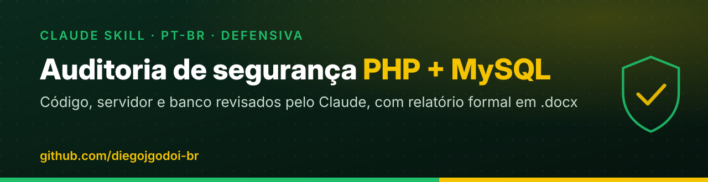

<div align="center">



<br>

[](https://agentskills.io/)
[](#-o-que-ela-analisa)
[](#)
[](LICENSE)

**Peça "audita a segurança deste sistema" e receba um relatório formal, com achados por severidade e a correção de cada um.**<br>
Feita para sistemas PHP + MySQL, principalmente os legados que precisam ser revisados antes de manutenção, reescrita ou publicação.

[**Instalar**](#-instalação) · [**O que analisa**](#-o-que-ela-analisa) · [**Como usar**](#-como-usar) · [**Relatório**](#-o-relatório) · [**Mais skills em português**](https://github.com/diegojgodoi-br/skills-ia-pt-br)

📚 **Cursos grátis de IA com certificado, 87 skills explicadas e guias em português:** [iacomousar.com.br](https://iacomousar.com.br/?utm_source=github&utm_medium=readme&utm_campaign=auditoria-seguranca-php-mysql)

⭐ **Se esta skill te ajudou, deixe uma estrela no repositório.** Isso ajuda mais gente a encontrar o projeto.

</div>

---

## 🔎 O que ela analisa

| Camada | O que o Claude verifica |
|---|---|
| 🐘 **Código PHP** | SQL Injection, XSS, CSRF, autenticação e sessão, upload de arquivos, controle de acesso (IDOR), inclusão de arquivos (LFI/RFI), dados sensíveis expostos |
| 🖥️ **Servidor** | `php.ini`, `.htaccess`/Nginx, `.env`, `.git/` e backups expostos, `phpinfo()` esquecido, headers de segurança (CSP, HSTS, X-Frame-Options) |
| 🗄️ **MySQL** | Usuário da aplicação com privilégio demais, uso de `root`, host `'%'`, senhas fracas, `my.cnf` (`bind-address`, `local-infile`, `secure-file-priv`) |

Cada achado sai com **categoria, arquivo:linha, severidade, explicação do risco e a correção concreta**, do crítico para o informativo.

| Severidade | Exemplos |
|---|---|
| 🔴 **Crítica** | Execução remota de código, SQLi sem login, credenciais expostas publicamente |
| 🟠 **Alta** | SQLi/XSS após login, upload sem validação, IDOR em dado sensível |
| 🟡 **Média** | Formulário sem token CSRF, headers de segurança ausentes, erro detalhado na tela |
| 🔵 **Baixa** | Boas práticas não seguidas, sem exploração direta |
| ⚪ **Informativa** | Sugestões de hardening |

## 🚀 Instalação

<details open>
<summary><b>No claude.ai (site ou app)</b></summary>

1. Ative **Execução de código e criação de arquivos** em *Configurações › Capacidades*.
2. Baixe o `seguranca-php-mysql.zip` na [página de Releases](https://github.com/diegojgodoi-br/auditoria-seguranca-php-mysql/releases/latest).
3. Vá em *Personalizar › Skills › + › Enviar uma skill* e escolha o `.zip`.

</details>

<details>
<summary><b>No Claude Code</b></summary>

```bash
git clone https://github.com/diegojgodoi-br/auditoria-seguranca-php-mysql.git
mkdir -p ~/.claude/skills
cp -r auditoria-seguranca-php-mysql/seguranca-php-mysql ~/.claude/skills/
```

No Claude Code ela funciona muito bem direto na pasta do projeto: o Claude varre o código com `grep`, lê o contexto de cada ocorrência e monta o relatório.

</details>

## 💬 Como usar

Depois de instalada, é só pedir normalmente. Por exemplo:

> *"Audita a segurança deste sistema PHP antes de eu reescrever."* (com o .zip do código anexado)<br>
> *"Revisa esse login.php e esse upload.php: tem SQL Injection ou XSS?"*<br>
> *"Esse é o php.ini e o .htaccess do servidor de produção. O que está perigoso?"*<br>
> *"A aplicação conecta no MySQL com este usuário. Os GRANTs estão adequados?"*

O Claude confirma o escopo (código, configs, acesso ao banco), analisa camada por camada e entrega o relatório.

## 📄 O relatório

O entregável padrão é um **Word (.docx)** pronto para arquivar ou mandar para a gestão. Se o ambiente não gerar .docx, o mesmo relatório sai em Markdown.

1. **Capa:** sistema, data e escopo
2. **Sumário executivo:** contagem por severidade e os riscos mais urgentes
3. **Metodologia e escopo:** o que foi e o que não foi analisado
4. **Achados detalhados:** código PHP, servidor e MySQL, do mais grave para o menos grave
5. **Recomendações priorizadas:** o que corrigir primeiro
6. **Apêndice técnico:** comandos e consultas usados na verificação

## 📁 Estrutura

```
seguranca-php-mysql/
├── SKILL.md                              # fluxo da auditoria
├── references/
│   ├── php-code-vulnerabilities.md       # checklist do código PHP
│   ├── server-infra-config.md            # checklist de servidor
│   └── mysql-security.md                 # checklist do MySQL
└── assets/
    └── estrutura-relatorio.md            # modelo do relatório
```

## ⚠️ Uso responsável

- A skill é **defensiva**: serve para auditar sistemas seus ou sob sua responsabilidade. Ela não gera exploits nem ataques prontos, só diagnóstico e correção.
- **Não substitui um pentest profissional** em sistemas críticos (pagamentos, dados de saúde, dados pessoais em larga escala).
- Revise o código antes de anexar e **não envie senhas, chaves ou dados reais de clientes** sem necessidade.

## 🤝 Contribua

Achou um padrão de vulnerabilidade que o checklist não cobre? [Abra uma issue](https://github.com/diegojgodoi-br/auditoria-seguranca-php-mysql/issues) ou mande um pull request.

---

<div align="center">

**Se a skill te ajudou a achar algo antes de ir para produção, deixe uma ⭐**

Feito por [Diego Godoi](https://github.com/diegojgodoi-br) · [iacomousar.com.br](https://iacomousar.com.br) · Licença [MIT](LICENSE)<br>
Veja também: [Skills de IA em português para 14 profissões](https://github.com/diegojgodoi-br/skills-ia-pt-br)

</div>
